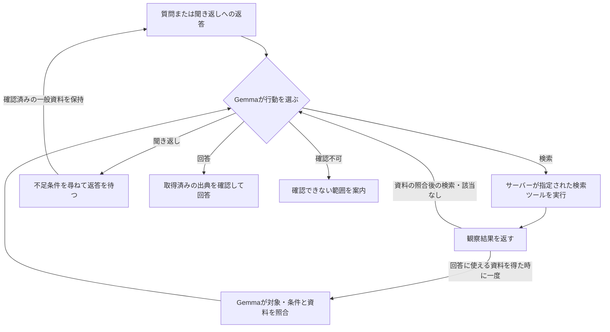

# やまだ案内のAgentic RAG設計

観光とくらしの質問を同じ画面で受け、回答に使った地域の資料を示す。Ollamaの `gemma4:12b` が検索の判断と回答を担当する。

## 実行時の役割

| 担当 | 採用する構成 | 入力と出力 |
| --- | --- | --- |
| 会話と判断 | Gemma 4 12B | 質問、会話の続き、ツールから得た観察結果を受け、検索・聞き返し・回答・確認不可のいずれかを選ぶ |
| ナレッジ検索 | TypeScriptの検索ツール | 検索語と対象を受け、根拠の候補を返す |
| 埋め込み | Ollamaの `embeddinggemma-2:270m` | 質問や資料のテキストを、類似度を計算できるベクトルに変換する |
| ReActの実行 | TypeScriptの実行処理 | モデルが指定したツールを実行して結果を返す。検索回数、聞き返しの続き、出典IDを管理する |

最初の行動からGemmaが選ぶ。検索するときは検索先と検索条件を指定し、結果を受けて次の行動を決める。選択肢と入力に適用する上限はサーバーが管理する。 [ReActの原論文](https://arxiv.org/abs/2210.03629)

## ナレッジの保管

町と観光協会から自動取得した本文はJSONで保管する。人が作成・確認するFAQは、`knowledge/` のMarkdownに出典と検索語を添えて保存する。一般検索に渡す前に、どちらも同じ項目を持つ資料として読み込む。地区別日程表は地区名と年度が決まれば照合できるため、専用のJSONと検索先を持つ。検索用の索引やベクトルを作る場合は、保存した本文から再生成できる形にする。 [LlamaIndexの資料読み込みガイド](https://developers.llamaindex.ai/python/framework/module_guides/loading/simpledirectoryreader/)

## エンベディングサーバと資料検索

一般検索の既定値はキーワードで、`--retrieval hybrid` で埋め込みを組み合わせる。ローカルOllamaの `/api/chat` で回答を生成し、`/api/embed` で検索用のベクトルを作る。埋め込みモデルはテキスト用の `embeddinggemma-2:270m`、ベクトルは768次元。埋め込み側の接続先は `YAMADA_EMBED_URL` で設定できる。モデルの入れ替え待ちや同時利用による遅延が実測で問題になった段階で、別プロセスの効果を比較する。 [Ollamaの埋め込みAPI](https://docs.ollama.com/api/embed) · [EmbeddingGemma 2のテキスト版](https://ollama.com/library/embeddinggemma-2:270m)

- 資料の取り込み時に見出しと本文を埋め込み、資料ID・埋め込みモデルの識別情報・入力形式・本文のハッシュと一緒にローカルのキャッシュに保存する。モデルや入力形式が変わったら再生成する。質問は問い合わせ時に同じモデルで埋め込む。
- 検索時には既存のキーワード検索と、ベクトル同士のコサイン類似度による検索を実行する。施設名や地区名の明示条件を優先し、同じ資料IDにまとまるように候補の順位を統合する。上位3件の抜粋をGemmaに渡す。`--retrieval hybrid` で起動した場合、各検索でキーワード・意味検索・併用を選べる。
- 駅を手がかりに通常の閉館時刻を比較するときは、質問にある駅名と閉館の項目をキーワード検索に補う。候補に駅と施設の関係を示す記載があり、同じ出典にその施設の通常時刻があれば、比較相手の時刻と合わせて最初の3件に取り込む。両施設の時刻が確認できた比較は、サーバーで時刻を比較して各項目に出典を付ける。
- 地区別のPDFから品目別の日付を取り込み、地区・年度・品目・期間を指定して照合する。地区と品目が特定でき、年月・今日・明日・次回の収集日だけを尋ねる定型質問は、サーバーが日程表から日付と曜日を返す。日本時間の今日を基準にし、次回は明日以降を探す。地区の情報だけが足りない定型質問は地区名を尋ね、地区名だけの返答で照合を続ける。出し方なども尋ねる場合はReActで扱う。出典欄には文書名とページを表示する。 [山田町の地区別ごみ収集日程表](https://www.town.yamada.iwate.jp/docs/8354.html)
- 埋め込みに接続できないときはキーワード検索に切り替え、評価ログに検索方式を残す。導入前後で、固有名を含む質問と日本語の言い換えを試し、必要な出典が上位3件に入る割合と応答時間を比較する。

本文と検索語には、モデルの文書検索用フォーマットを適用する。 [EmbeddingGemma 2のモデルカード](https://gemma.ai/models/embeddinggemma/model-card-v2/#task-instruction-prefixes)

```text
資料   title: {見出し} | text: {本文}
検索語 task: search result | query: {検索語}
```

## ReActのループ

Webと評価コマンドで共通のReAct処理を使う。日程表だけで回答できる定型質問を先に判定する。ReActに進むと、Gemmaに質問、会話から確認済みの条件、使えるツール、残りの検索回数を渡して、最初の行動を選ばせる。検索を選んだ場合は、サーバーがツールを実行して結果を観察として返す。Gemmaは観察を踏まえて次の行動を選ぶ。 [ReActの原論文](https://arxiv.org/abs/2210.03629)



| 行動 | モデルから受け取る主な項目 | サーバーの処理 |
| --- | --- | --- |
| `search` | 不足している項目、検索先、検索条件 | 検索先と引数を確認し、登録済みの資料を検索する。成功・該当なし・実行エラーの状態と、取得した資料ID・見出し・本文・出典を観察として返す |
| `clarify` | 不足している条件 | ごみ収集日の地区名を尋ねる。元の質問に加え、取得済みの一般資料を最大3件保持し、返答と合わせてGemmaへ渡す |
| `answer` | 回答文、参照した資料ID | 参照したIDが取得済みの資料に含まれることを確認する。表示するURLは資料の登録情報から取得する |
| `insufficient` | 確認できなかった項目 | 登録資料から根拠を確認できない旨を、サーバーが定型文で返す |

Gemmaの行動をOllamaの構造化JSON出力で受け、サーバーが `search` をツール実行に変換する。回答できる状態になった時点で、対象、年・時期、料金、例外、複数の質問項目と取得資料をGemmaが一度照合する。裏づけになる資料IDと不足項目を次の行動判断に渡す。通常の単一項目の質問は、検索の判断、資料の照合、回答の判断で3回となる。

1入力の検索は詳細検索を含めて最大5回、行動判断は最大6回。これに資料の照合が最大1回加わる。検索先と引数が同じ場合は前の観察を利用する。最後の行動判断では回答・聞き返し・確認不可から選ぶ。除外条件がある質問の候補文の照合と、AIの応答を読み取れなかった場合の作り直しはそれぞれ別に実行する。評価コマンドでは選んだ行動、資料照合、検索条件、取得した資料ID、応答時間を記録する。 [Ollamaの構造化出力](https://docs.ollama.com/capabilities/structured-outputs)

| 検索先 | 渡す引数 | 観察として返す情報 |
| --- | --- | --- |
| `official_documents` | 検索語、必要に応じて検索方式 | 登録資料の上位3件、本文の抜粋、追加で読める節の見出し |
| `source_details` | 観察済みの資料ID、不足項目の検索語 | 同じ出典URLの本文の続きや関連する節を最大2件 |
| `collection_calendars` | 地区・年度・期間・品目 | 構造化済みの日程表を照合した結果 |

岩手船越駅から行ける施設とおいすたを比べるとき、最初の検索で科学館のアクセス資料が見つかる。その資料から読める節の見出しを確認して、次は開館時間を詳しく読む。Gemmaは、アクセスと両施設の時刻の根拠をそろえて比較を答える。

```json
{
  "action": "search",
  "target": "source_details",
  "source_id": "museum-access",
  "query": "開館時間 閉館時刻",
  "missing_fact": "鯨と海の科学館の閉館時刻"
}
```

検索の本文上限は抜粋600、詳細800、聞き返し前の抜粋300 UTF-16コード単位。本文には省略の有無を付け、同じ抜粋の再送を避ける。聞き返し時の資料はサーバー内に15分間保持する。返答を受けたら、その入力の検索枠で日程表を照合する。

### 会話例

1. 利用者が「うちの地区のごみ収集日はいつですか？」と聞く。
2. Gemmaが地区名の `clarify` を選ぶ。アプリが地区名を聞き、収集日程の案内を続けるために元の質問を保持する。
3. 利用者が「大沢です」と答える。
4. Gemmaが地区と期間を指定し、各品目の次回収集日を照合して回答する。元の質問で品目が指定されていれば、その条件を使う。「不燃」「雑誌」のように日程表の区分に対応する品目や、1地区に特定できる地名は質問文から照合する。一般的な「ごみ収集日」の質問では6区分を案内する。

## 開発タスクの分担案

開発ではSolとLunaで作業を分担する。案内の回答と行動判断にはGemma 4 12Bを使う。定型データ整備も推論強度を `xhigh`（Extra high）以上にする。 [GPT-6 Lunaの設定](https://developers.openai.com/api/docs/models/gpt-6-luna) · [Codexのサブエージェント](https://learn.chatgpt.com/docs/agent-configuration/subagents)

| 開発担当 | モデルの候補 | 担当する成果物 |
| --- | --- | --- |
| 設計・統合レビュー | GPT-6.2 Sol、推論 `high` | 行動の形式、検索ツールとの境界、会話の引き継ぎ、評価結果のレビュー |
| ReAct・画面 | GPT-6.2 Sol、推論 `high` | 行動と観察のループ、Web API、聞き返しを続けられる画面 |
| 埋め込み・検索 | GPT-6.2 Sol、推論 `medium` | 埋め込みAPIの接続、ベクトルのキャッシュ、検索候補の統合 |
| 定型データ整備 | GPT-6 Luna、推論 `xhigh` 以上。Lunaを指定できない場合はGPT-6.2 Solの `xhigh` 以上 | 公式の地区名・資料URLの転記、評価ケースの整形 |

行動と観察結果の形式を先に決め、ReAct、検索、評価データは担当ファイルを分けて進める。統合レビューは同じGPT-6.2 Solを使う別の担当が行い、実装とは独立して出典と評価結果を確認する。レビュー担当にSolを使うことで、開発時のトークン消費を抑える。

## 評価

`npm run evaluate:server` で、Webと同じTypeScriptのReActを使う。34問で回答・出典・行動を確認し、19問で必要な資料が検索の上位3件に入る割合を測る。出典IDの照合で、Gemmaが引用した資料を実際に取得したことを確認する。回答中の各主張が資料に沿っているかは、実際の回答と資料を照らし合わせる。 [設計調査ノート](agentic-rag-research.md)
