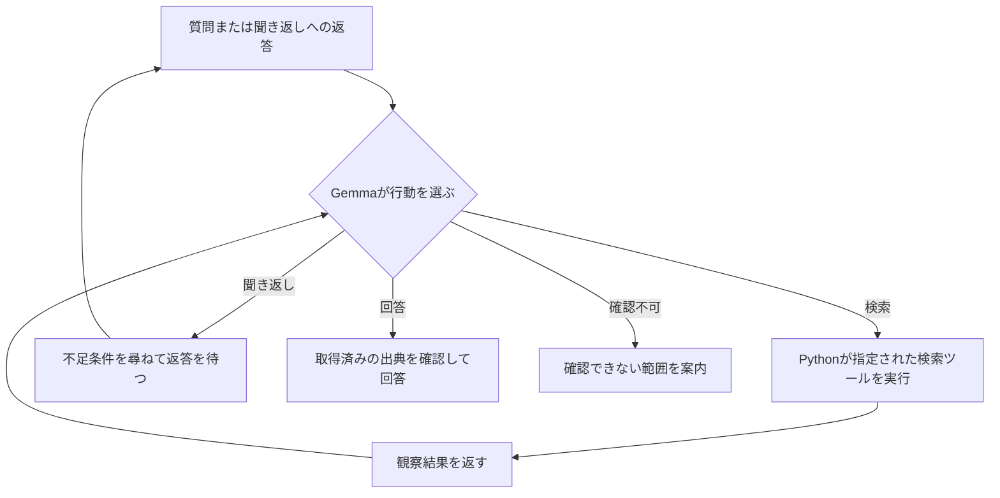

# やまだ案内のAgentic RAG設計

観光とくらしの質問を同じ画面で受け、回答に使った地域の資料を示す。ReAct初版の回答モデルは、Ollamaの `gemma4:12b` を基準にする。

## 実行時の役割

| 担当 | 採用する構成 | 入力と出力 |
| --- | --- | --- |
| 会話と判断 | Gemma 4 12B | 質問、会話の続き、ツールから得た観察結果を受け、検索・聞き返し・回答・確認不可のいずれかを選ぶ |
| ナレッジ検索 | Pythonの検索ツール | 検索語と対象を受け、根拠の候補を返す |
| 埋め込み | Ollamaの `embeddinggemma-2:270m` | 質問や資料のテキストを、類似度を計算できるベクトルに変換する |
| ReActの実行 | Pythonの共通処理 | モデルが指定したツールを実行して結果を返す。検索回数、聞き返しの続き、出典IDを管理する |

最初の行動からGemmaが選び、検索するときは検索先と検索条件を指定する。検索処理は独立したツールとして実装する。現行試作の評価では、根拠がそろっている施設比較で再検索が発生し、その一問は初回検索のみの19.40秒に対し40.40秒かかった。ReAct版でも、根拠の取りこぼしと回答までの時間を測る。 [ReActの原論文](https://arxiv.org/abs/2210.03629) · [Agentic RAGの設計ガイド](https://learn.microsoft.com/en-us/azure/architecture/ai-ml/guide/rag/rag-agentic)

検索語の組み立てが原因で必要な根拠を繰り返し取りこぼす場合は、検索専用サブエージェントを比較する。渡すのは「元の質問・確認済みの条件・不足項目」。受け取るのは「検索対象・検索条件・資料候補」。まず同じ `gemma4:12b` を検索役にも使って役割分担の効果を測る。検索モデルの軽量化を試す場合は `gemma4:e4b` を候補にし、必要な資料が取れる割合と回答までの時間を比較する。 [OllamaのGemma 4モデル一覧](https://ollama.com/library/gemma4)

## ナレッジの保管

町と観光協会から自動取得した本文はJSONで保管する。人が作成・確認するFAQは、`knowledge/` のMarkdownに出典と検索語を添えて保存する。一般検索に渡す前に、どちらも同じ項目を持つ資料として読み込む。地区別日程表は地区名と年度が決まれば照合できるため、専用のJSONと検索先を持つ。検索用の索引やベクトルを作る場合は、保存した本文から再生成できる形にする。 [LlamaIndexの資料読み込みガイド](https://developers.llamaindex.ai/python/framework/module_guides/loading/simpledirectoryreader/)

## エンベディングサーバと資料検索

ReAct初版の一般検索にはキーワードを使う。埋め込みを追加する段階では、同じローカルOllamaで回答用の `/api/chat` と埋め込み用の `/api/embed` を提供する。埋め込みモデルはテキスト用の `embeddinggemma-2:270m`、ベクトルは768次元。二つのAPIの接続先は別々に設定できる形にし、モデルの入れ替え待ちや同時利用による遅延が実測で問題になった時点で、埋め込み側を別ポート・別プロセスで試す。選んだ埋め込みモデルの動作・山田町資料での検索精度は、実装時に検証する。 [Ollamaの埋め込みAPI](https://docs.ollama.com/api/embed) · [EmbeddingGemma 2のテキスト版](https://ollama.com/library/embeddinggemma-2:270m)

- 資料の取り込み時に見出しと本文を埋め込み、資料ID・埋め込みモデルの識別情報・入力形式・本文のハッシュと一緒にローカルのキャッシュに保存する。モデルや入力形式が変わったら再生成する。質問は問い合わせ時に同じモデルで埋め込む。
- 検索時には既存のキーワード検索と、ベクトル同士のコサイン類似度による検索を実行する。施設名や地区名の明示条件を優先し、同じ資料IDにまとまるように候補の順位を統合する。初版は上位3件をGemmaに渡す。
- 地区別のPDFから品目別の日付を取り込み、地区・年度・品目・期間を指定して照合する。Gemmaが条件と回答に使う資料IDを選び、Pythonが照合した日付と曜日を回答に入れる。出典欄には文書名とページを表示する。 [山田町の地区別ごみ収集日程表](https://www.town.yamada.iwate.jp/docs/8354.html)
- 埋め込みに接続できないときはキーワード検索に切り替え、評価ログに検索方式を残す。導入前後で、固有名を含む質問と日本語の言い換えを試し、必要な出典が上位3件に入る割合と応答時間を比較する。

本文と検索語には、モデルの文書検索用フォーマットを適用する。 [EmbeddingGemma 2のモデルカード](https://gemma.ai/models/embeddinggemma/model-card-v2/#task-instruction-prefixes)

```text
資料   title: {見出し} | text: {本文}
検索語 task: search result | query: {検索語}
```

## ReActのループ

Webと評価コマンドで共通のReAct処理を使う。利用者から入力があったら、Gemmaに質問、会話から確認済みの条件、使えるツール、残りの検索回数を渡して、最初の行動を選ばせる。検索を選んだ場合は、Pythonがツールを実行して結果を観察として返す。Gemmaは観察を踏まえて次の行動を選ぶ。 [ReActの原論文](https://arxiv.org/abs/2210.03629)



| 行動 | モデルから受け取る主な項目 | Pythonの処理 |
| --- | --- | --- |
| `search` | 不足している項目、検索先、検索条件 | 検索先と引数を確認し、登録済みの資料を検索する。成功・該当なし・実行エラーの状態と、取得した資料ID・見出し・本文・出典を観察として返す |
| `clarify` | 不足している条件 | 初版はごみ収集日の地区名に対応。元の質問と確認中の条件を保持して、利用者の返答を待つ |
| `answer` | 回答文、参照した資料ID | 参照したIDが取得済みの資料に含まれることを確認する。表示するURLは資料の登録情報から取得する |
| `insufficient` | 確認できなかった項目 | その項目は公式資料から確認できないと表示する。案内先が確認できた場合は公式リンクを示す |

初版では、Gemmaの行動をOllamaの構造化JSON出力で受け、Pythonが `search` をツール実行に変換する。利用者からの1入力につき検索は合計最大2回、Gemmaの行動判断は最大3回とする。検索先と引数が同じ場合は前の観察を利用する。検索枠を使い切ったときと最後の行動判断では、選べる行動を回答・聞き返し・確認不可に絞る。ログには選んだ行動、検索条件、取得した資料ID、応答時間を記録する。 [Ollamaの構造化出力](https://docs.ollama.com/capabilities/structured-outputs)

検索先は、町や地域の団体・施設などの登録済み資料を探す `official_documents` と、地区・年度で日程表を引く `collection_calendars`。岩手船越駅の資料から科学館名までは判明した場合、次の行動で開館時間を探す。両施設の通常の閉館時刻がそろったら回答に進む。

```json
{
  "action": "search",
  "target": "official_documents",
  "query": "鯨と海の科学館 開館時間",
  "missing_fact": "鯨と海の科学館の通常の閉館時刻"
}
```

### 会話例

1. 利用者が「うちの地区のごみ収集日はいつですか？」と聞く。
2. Gemmaが地区名の `clarify` を選ぶ。アプリが地区名を聞き、収集日程の案内を続けるために元の質問を保持する。
3. 利用者が「大沢です」と答える。
4. Gemmaが地区と期間を指定し、各品目の次回収集日を照合して回答する。元の質問で品目が指定されていれば、その条件を使う。

## 開発タスクの分担案

開発ではSol・Astra・Lunaで作業を分担する。案内の回答と行動判断にはGemma 4 12Bを使う。定型データ整備も推論強度を `xhigh`（Extra high）以上にする。 [GPT-6 Lunaの設定](https://developers.openai.com/api/docs/models/gpt-6-luna) · [Codexのサブエージェント](https://learn.chatgpt.com/docs/agent-configuration/subagents)

| 開発担当 | モデルの候補 | 担当する成果物 |
| --- | --- | --- |
| 設計・統合レビュー | GPT-6.2 Astra、推論 `high` | 行動の形式、検索ツールとの境界、会話の引き継ぎ、評価結果のレビュー |
| ReAct・画面 | GPT-6.2 Sol、推論 `high` | 行動と観察のループ、Web API、聞き返しを続けられる画面 |
| 埋め込み・検索 | GPT-6.2 Sol、推論 `medium` | 埋め込みAPIの接続、ベクトルのキャッシュ、検索候補の統合 |
| 定型データ整備 | GPT-6 Luna、推論 `xhigh` 以上。Lunaを指定できない場合はGPT-6.2 Solの `xhigh` 以上 | 公式の地区名・資料URLの転記、評価ケースの整形 |

行動と観察結果の形式を先に決め、ReAct、検索、評価データは、それぞれの担当ファイルを分けて進める。Astraのレビューでは、実装から独立した観点で出典と会話の引き継ぎを確認する。このチャットのサブエージェントではSolとAstraの明示指定を確認済み。Lunaの割り当ては利用できる環境で確認してから適用する。

## 実装順と確認項目

1. キーワード検索と地区別日程表の照合をツールにし、Gemmaが最初の行動を選ぶReActループにつなぐ。`clarify` と会話の続きを扱い、Web画面で「地区名を聞く → 大沢の収集日を答える」を通す。
2. ナレッジ検索ツールに埋め込みを接続し、キーワード検索だけの場合と比較する。日本語の言い換えで必要な資料を得られるか、施設名・地区名の一致を保てるかを確認する。
3. 検索結果の不足理由を記録し、追加検索の要否を評価する。固有名で質問する施設比較は初回で必要な根拠がそろえば回答する。駅から施設を特定する質問は、必要な資料が欠けている場合に補う。混雑など資料にない質問は確認できない旨を伝える。

既存の10問に加え、聞き返しを含む2ターンの質問と言い換えを用意する。現行試作の初回検索のみ・追加検索ありを比較用の基準にして、ReAct版で回答・出典・応答時間、選んだ行動、検索条件、資料ID、検索回数を比較する。変更理由を日本語でコミット本文に書き、検証できた区切りでpushする。
