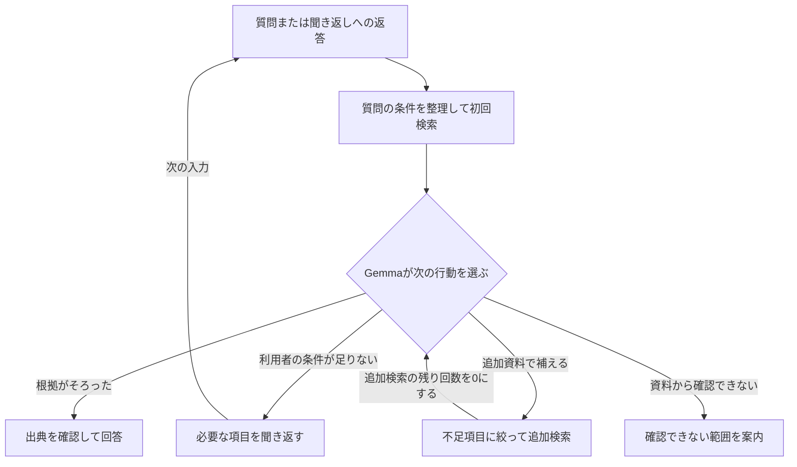

# やまだ案内のAgentic RAG設計

初版の設計案。観光とくらしの質問を同じ画面で受け、回答に使った町や施設の公式資料を示す。実行時の回答モデルは、Ollamaの `gemma4:12b` を基準にする。

## 実行時の役割

| 担当 | 採用する構成 | 入力と出力 |
| --- | --- | --- |
| 会話と判断 | Gemma 4 12B | 質問、会話の続き、取得した根拠を受け、回答・聞き返し・追加検索・確認不可のいずれかを選ぶ |
| ナレッジ検索 | Pythonの検索ツール | 検索語と対象を受け、根拠の候補を返す |
| 埋め込み | Ollamaの `embeddinggemma-2:270m` | 質問や資料のテキストを、類似度を計算できるベクトルに変換する |
| ワークフロー | Pythonの共通処理 | 検索の回数、聞き返しの続き、出典IDの検証、結果の表示を管理する |

検索を呼び出す判断と検索語の作成は、最初は会話担当のGemmaが行う。検索処理は独立したツールとして実装する。現在の評価では、根拠がそろっている施設比較で再検索が発生し、その一問は初回検索のみの19.40秒に対し40.40秒かかった。検索を分担する効果は、候補資料の取りこぼしと回答までの時間を測って判断する。 [Agentic RAGの設計ガイド](https://learn.microsoft.com/en-us/azure/architecture/ai-ml/guide/rag/rag-agentic)

検索語の組み立てが原因で必要な根拠を繰り返し取りこぼす場合は、検索専用サブエージェントを比較する。渡すのは「元の質問・確認済みの条件・不足項目」。受け取るのは「検索対象・検索条件・資料候補」。まず同じ `gemma4:12b` を検索役にも使って役割分担の効果を測る。検索モデルの軽量化を試す場合は `gemma4:e4b` を候補にし、必要な資料が取れる割合と回答までの時間を比較する。 [OllamaのGemma 4モデル一覧](https://ollama.com/library/gemma4)

## エンベディングサーバと資料検索

ローカルのOllama一つで、回答用の `/api/chat` と埋め込み用の `/api/embed` を提供する。初版の埋め込みモデルはテキスト用の `embeddinggemma-2:270m`、ベクトルは768次元。二つのAPIの接続先は別々に設定できる形にし、モデルの入れ替え待ちや同時利用による遅延が実測で問題になった時点で、埋め込み側を別ポート・別プロセスで試す。選んだ埋め込みモデルの動作・山田町資料での検索精度は、実装時に検証する。 [Ollamaの埋め込みAPI](https://docs.ollama.com/api/embed) · [EmbeddingGemma 2のテキスト版](https://ollama.com/library/embeddinggemma-2:270m)

- 資料の取り込み時に見出しと本文を埋め込み、資料ID・埋め込みモデルの識別情報・入力形式・本文のハッシュと一緒にローカルのキャッシュに保存する。モデルや入力形式が変わったら再生成する。質問は問い合わせ時に同じモデルで埋め込む。
- 検索時には既存のキーワード検索と、ベクトル同士のコサイン類似度による検索を実行する。施設名や地区名の明示条件を優先し、同じ資料IDにまとまるように候補の順位を統合する。初版は上位3件をGemmaに渡す。
- 収集日程表は地区と年度の一覧から検索する。地区名を確認できたら、該当する町のPDFを返す。具体的な日付の回答は、日程表から地区・年度・ごみの品目別の日付を取り込み、照合できる段階で扱う。 [山田町の地区別ごみ収集日程表](https://www.town.yamada.iwate.jp/docs/8354.html)
- 埋め込みに接続できないときはキーワード検索に切り替え、評価ログに検索方式を残す。導入前後で、固有名を含む質問と日本語の言い換えを試し、必要な出典が上位3件に入る割合と応答時間を比較する。

本文と検索語には、モデルの文書検索用フォーマットを適用する。 [EmbeddingGemma 2のモデルカード](https://gemma.ai/models/embeddinggemma/model-card-v2/#task-instruction-prefixes)

```text
資料   title: {見出し} | text: {本文}
検索語 task: search result | query: {検索語}
```

## ワークフロー

一つのPython処理をWebと評価コマンドから使う。初回検索で得た資料をGemmaに渡し、構造化された行動を受け取る。Pythonが検索の実行と回数の上限を管理する。



| 行動 | モデルから受け取る主な項目 | ワークフローで確認すること |
| --- | --- | --- |
| `answer` | 回答文、参照した資料ID | 参照したIDがこの質問で取得した資料に含まれること。表示するURLは資料の登録情報から組み立てる |
| `clarify` | 不足している条件 | 初版はごみ収集日の地区名に対応。元の質問と確認中の条件を保持し、次の入力を受けて検索を続ける |
| `search` | 不足している項目、検索語、検索対象 | 追加検索は質問への一回の応答につき最大1回。同じ検索の繰り返しを避け、登録済みの資料を検索する |
| `insufficient` | 確認できなかった項目 | その項目は公式資料から確認できないと表示する。案内先が確認できた場合は公式リンクを示す |

`search` は質問に答えるために必要な事実を指定する。たとえば「両施設が通常何時に閉館するか」がそろった時点で回答する。岩手船越駅の資料から科学館名だけが判明した場合は、追加検索の対象をその科学館の開館時間に絞る。

検索先は、自由文で町や施設の公式資料を探す `official_documents` と、地区・年度で日程表を引く `collection_calendars` から始める。

```json
{
  "action": "search",
  "target": "official_documents",
  "query": "鯨と海の科学館 開館時間",
  "missing_fact": "鯨と海の科学館の通常の閉館時刻"
}
```

### 会話例

1. 利用者が「うちの地区のごみ収集日はいつですか？」と聞く。
2. アプリが地区名を聞き、収集日程の案内を続けるために元の質問を保持する。
3. 利用者が「大沢です」と答える。
4. アプリが町の一覧から大沢の該当年度のPDFを示す。具体的な日付は、登録済みの日程データで確認できる範囲を案内する。

## 開発タスクの分担案

開発ではSol・Astra・Lunaで作業を分担する。案内の回答と行動判断にはGemma 4 12Bを使う。定型データ整備も推論強度を `xhigh`（Extra high）以上にする。 [GPT-6 Lunaの設定](https://developers.openai.com/api/docs/models/gpt-6-luna) · [Codexのサブエージェント](https://learn.chatgpt.com/docs/agent-configuration/subagents)

| 開発担当 | モデルの候補 | 担当する成果物 |
| --- | --- | --- |
| 設計・統合レビュー | GPT-6.2 Astra、推論 `high` | 行動の形式、検索ツールとの境界、会話の引き継ぎ、評価結果のレビュー |
| ワークフロー・画面 | GPT-6.2 Sol、推論 `high` | Python側の行動分岐、Web API、聞き返しを続けられる画面 |
| 埋め込み・検索 | GPT-6.2 Sol、推論 `medium` | 埋め込みAPIの接続、ベクトルのキャッシュ、検索候補の統合 |
| 定型データ整備 | GPT-6 Luna、推論 `xhigh` 以上。Lunaを指定できない場合はGPT-6.2 Solの `xhigh` 以上 | 公式の地区名・資料URLの転記、評価ケースの整形 |

行動と検索結果の形式を先に決め、ワークフロー、検索、評価データは、それぞれの担当ファイルを分けて進める。Astraのレビューでは、実装から独立した観点で出典と会話の引き継ぎを確認する。このチャットのサブエージェントではSolとAstraの明示指定を確認済み。Lunaの割り当ては利用できる環境で確認してから適用する。

## 実装順と確認項目

1. 共通ワークフローに `clarify` と会話の続きを追加し、Web画面で「地区名を聞く → 大沢のPDFを案内する」を通す。
2. ナレッジ検索ツールに埋め込みを接続し、キーワード検索だけの場合と比較する。日本語の言い換えで必要な資料を得られるか、施設名・地区名の一致を保てるかを確認する。
3. 検索結果の不足理由を記録し、追加検索の要否を評価する。固有名で質問する施設比較は初回で必要な根拠がそろえば回答する。駅から施設を特定する質問は、必要な資料が欠けている場合に補う。混雑など資料にない質問は確認できない旨を伝える。

既存の10問に加え、聞き返しを含む2ターンの質問と言い換えを用意する。自動評価は回答・出典・応答時間に加え、選んだ行動、検索語、資料ID、検索回数を比較する。変更理由を日本語でコミット本文に書き、検証できた区切りでpushする。
